# 个人资产管理系统

<p align="center">
  
  
  
  
  
  
  
</p>

本地自部署的单人资产账本：**截图即录入、凭证可追溯、机器给信号、人做裁决**。
记下每个资产项在不同日期的金额快照，据此给出净值、占比、趋势、目标偏离与预警。

适合：想完全掌控财务数据的单人/家庭，本地部署。不适合：多人协作、公网服务、开箱即用的云记账。

> [!IMPORTANT]
> **本仓库是 V5 世系的终态存档（`v5-final`），不再接受功能变更。**
> 本文描述的每一项行为都对应终态代码；此后进入系统重构，改动不在本仓库继续。
> 仓库设为归档只读，**不受理 issue 与 PR**；欢迎按 MIT 许可自由 fork（保留版权行；fork 为非官方延续，与本仓库无隶属关系）。
> 系统重构在独立仓库进行（链接待补）。
> 版本沿革见 [CHANGELOG.md](CHANGELOG.md)，领域词条见 [CONTEXT.md](CONTEXT.md)，为什么做成这样见 [MISSION.md](MISSION.md) 与 [docs/adr/](docs/adr/)。

<p align="center">
  <a href="./README_EN.md">English</a>（已停止维护） | 简体中文
</p>

---

## 界面预览

> 截图来自真实界面，数据为合成示例（虚构机构与标的），仅用于展示功能形态。

**核心账本**

| 总览 | 资产记录 |
|:---:|:---:|
| 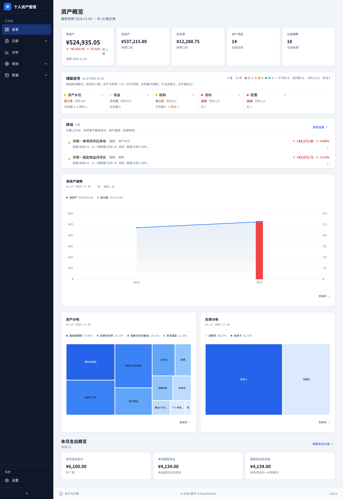 | 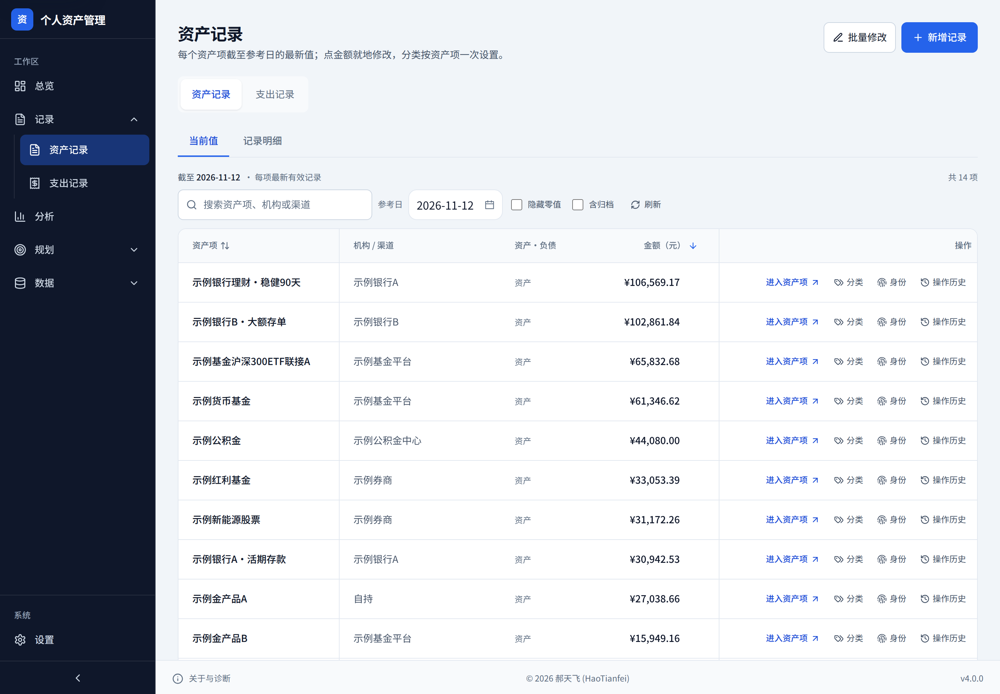 |
| 净值、域级信号、趋势与分布 | 每项最新值，就地修改、分类与身份管理 |

| 支出记录 | 数据分析 |
|:---:|:---:|
| 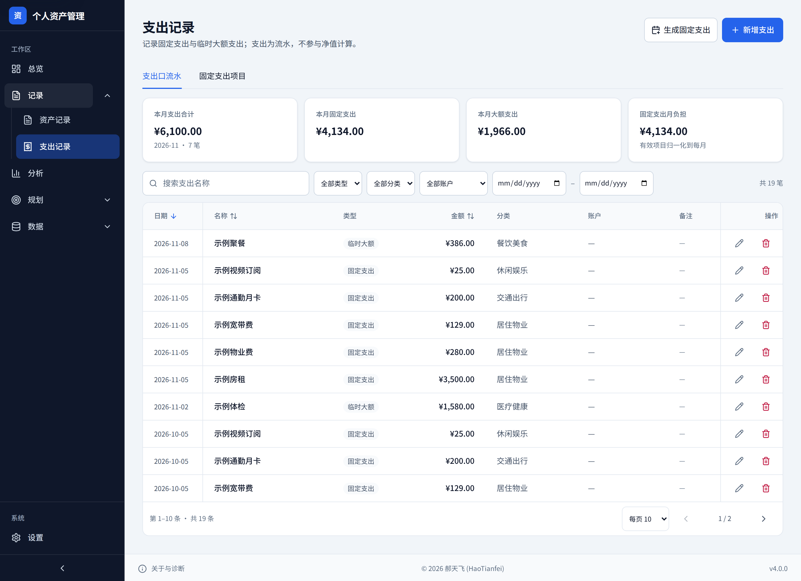 | 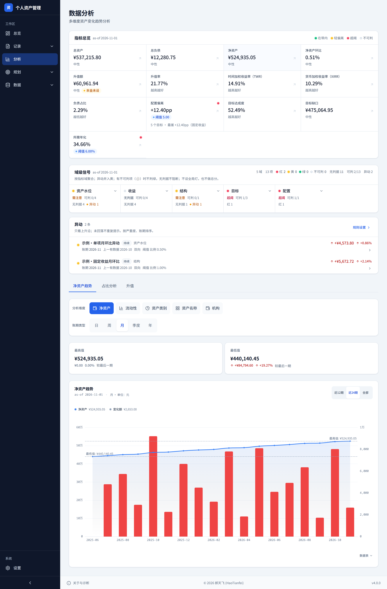 |
| 固定与大额支出，按月归集 | 多维趋势、TWR/XIRR、异动预警 |

**规划与预警**

| 目标配置 | 资产类别目标 |
|:---:|:---:|
| 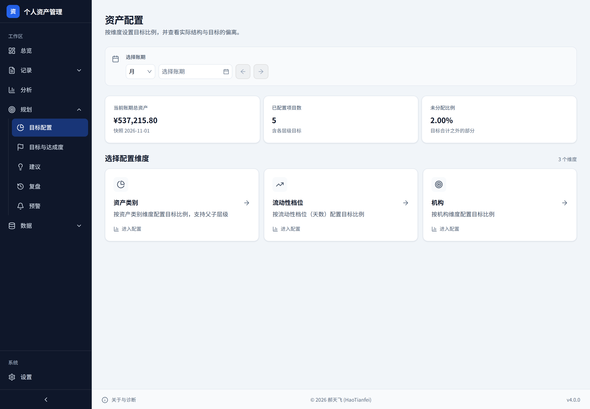 | 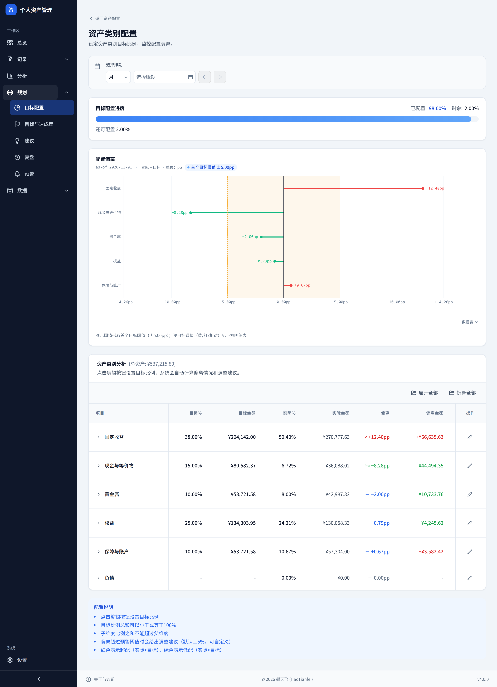 |
| 按类别/流动性/机构三维度设目标 | 父子层级目标与实际偏离 |

| 目标与达成度 | AI 建议 |
|:---:|:---:|
| 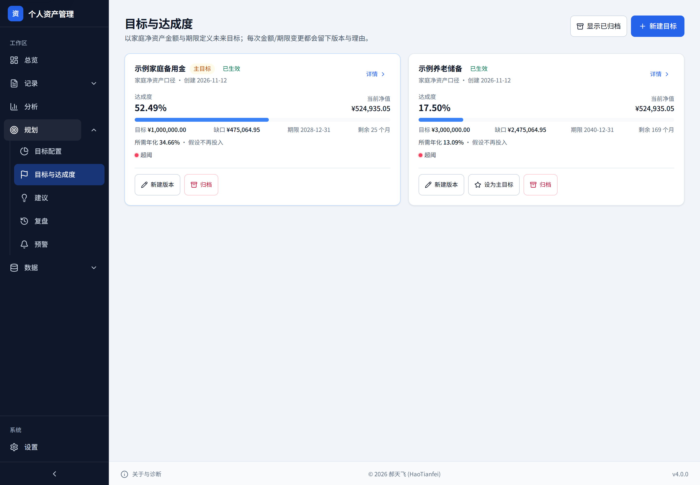 | 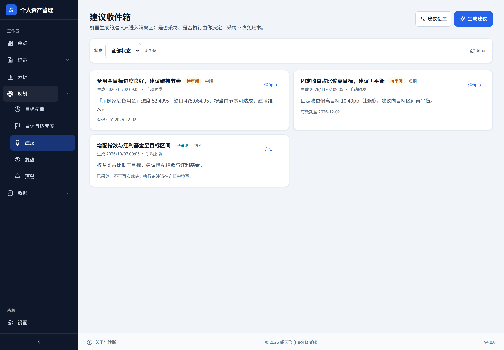 |
| 财务目标版本化，达成度跟踪 | 机器给信号、人做裁决 |

| 复盘 | 预警 |
|:---:|:---:|
| 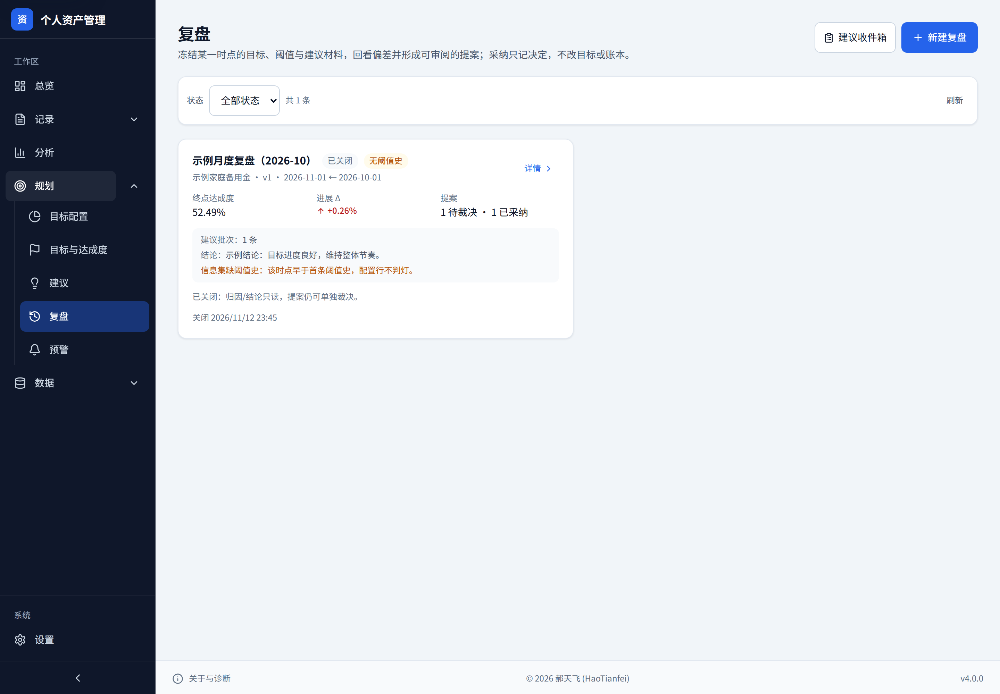 | 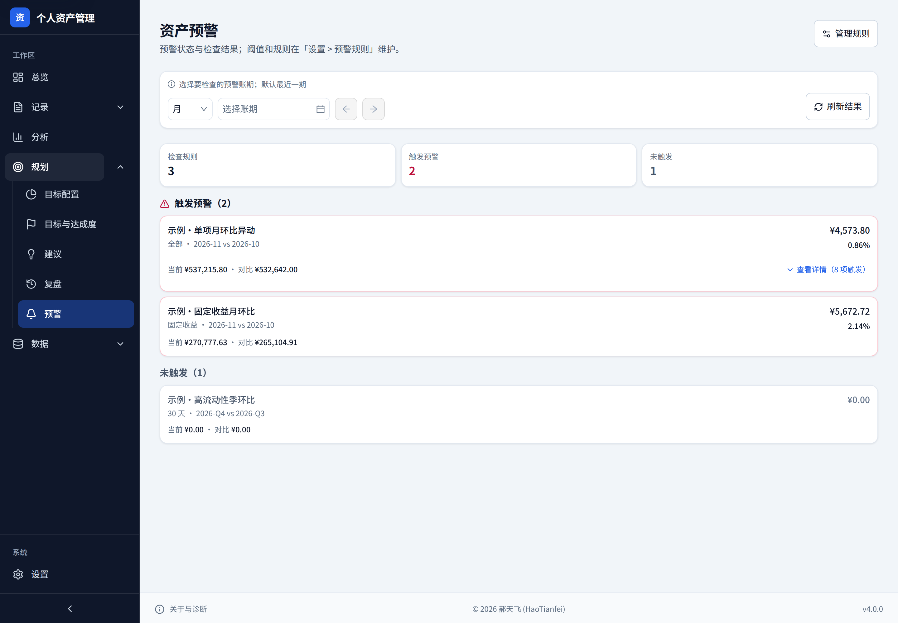 |
| 区间归因与建议采纳回顾 | 阈值规则与触发记录 |

**OCR 与 AI**

| 截图录入 | 凭证库 |
|:---:|:---:|
| 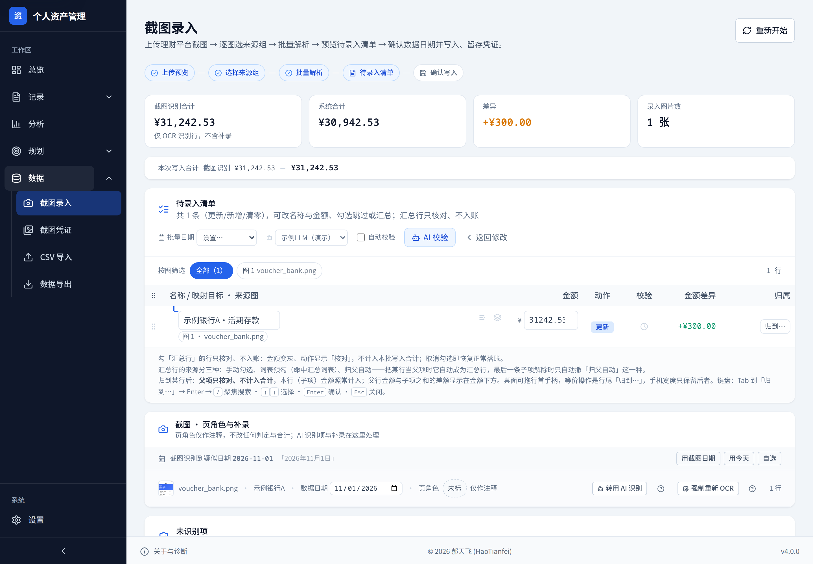 | 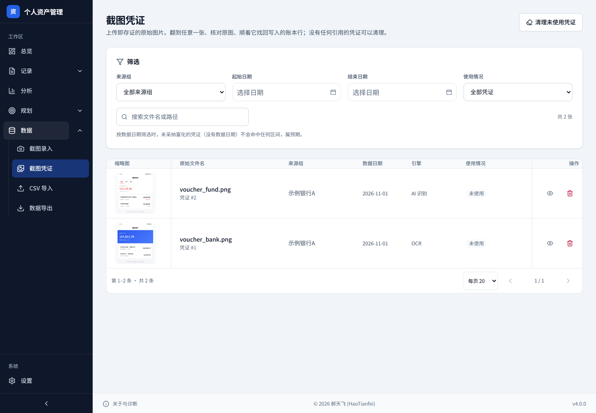 |
| 截图即录入：OCR 解析、逐行核对 | OCR/AI 双引擎凭证留痕 |

| LLM 提供商 | 审计日志 |
|:---:|:---:|
| 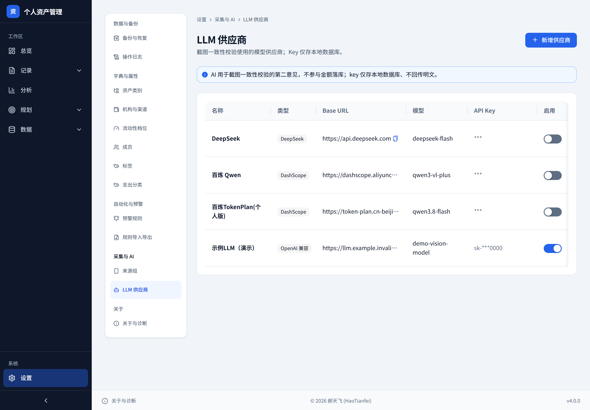 | 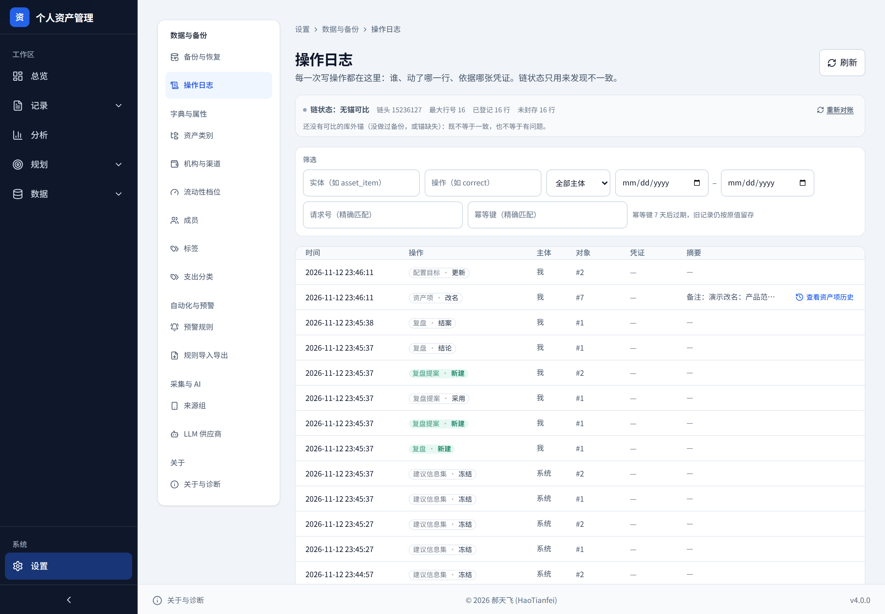 |
| 多提供商配置，密钥本地保存 | 全操作留痕，审计链可校验 |

---

## 目录

- [界面预览](#界面预览)
- [为什么做这个](#为什么做这个)
- [核心概念](#核心概念)
- [功能地图](#功能地图)
- [三条口径红线](#三条口径红线)
- [技术栈](#技术栈)
- [项目结构](#项目结构)
- [快速开始](#快速开始)
- [三环境与上线](#三环境与上线)
- [质量门禁](#质量门禁)
- [备份与恢复](#备份与恢复)
- [文档地图](#文档地图)
- [已知边界](#已知边界)
- [许可证](#许可证)

---

## 为什么做这个

四个真实痛点决定了这个项目的形状（详见 [MISSION.md](MISSION.md)）：

| 痛点 | 表现 | 项目给出的回答 |
|------|------|----------------|
| 录入麻烦 | 打开多个 App 手工汇总，数据滞后、易漏录错录 | 截图 OCR 识别 → 人工核对 → 采纳入账；另有 CSV 导入 |
| 分不清本金与收益 | 只有快照、没有流水，算不出真实收益率 | 以「累计投入本金」口径给出升值额/升值率，并支持时间加权收益（TWR） |
| 配置靠感觉 | 无目标配置与再平衡依据 | 目标配置、偏离分析、调整建议、预警；多套业界配置目标 × 风险偏好 |
| 无凭证不可查证 | 录错了追不回来源、无法对账 | 原图存证（含 SHA256）+ 识别快照 + 导入批次，数据来路可回溯 |

**不做**流水级记账、不做现金流/收入支出拆解 —— 它是账本（变更日志），不是复式记账系统。
**不做**多用户与权限体系 —— 单人本地部署，`owner` 维度只为将来升级到家庭盘点留支点。

## 核心概念

完整定义见 [CONTEXT.md](CONTEXT.md)，这里是理解代码必读的八个：

| 概念 | 一句话 |
|------|--------|
| **资产项** | 一个持久身份，由 `asset_items.id` 标识，对应「某机构下的某产品」。改名只追加显示名历史，身份不变 |
| **资产记录** | 某资产项在某个日期的金额测量值（`assets` 表一行），标明资产还是负债；金额非负，0 是合法测量值 |
| **项级元数据** | 挂在资产项上的分类、标签、归属、流动性、备注。改它们**不刷新**任何记录行的 `updated_at`，唯一写入口是「进入资产项」抽屉 |
| **更正链** | 账本行 write-once：改金额不覆盖，而是写 `superseded_by` 标记并追加更正行 |
| **沿用值** | as-of（截至某日）汇总的产物 —— 某资产项截至该日的最新一条有效记录。期内没更新过的项**沿用旧值，不置零、不估算** |
| **当前值** | 单个资产项粒度的沿用值，永远连同「它的记录日期」一起呈现，不落库 |
| **草稿 / 归档** | 在用＝`active` + `draft`（草稿也计入净值，只是分类未补齐）；归档＝退出计量，不进净值/占比/预警/合计，但历史与血缘保留 |
| **血缘** | 合并、拆分、口径承接登记在 `lineage_links`，前身项登记即归档 |

## 功能地图

六个入口，覆盖「录入 → 核对 → 分析 → 规划 → 留痕」的完整闭环：

| 入口 | 能力 |
|------|------|
| **总览** `/` | 净值与构成、趋势、占比、身份漂移诊断、当前值速览 |
| **记录** | 资产记录（当前值 / 记录明细双视图，金额就地可改，默认按更新时间排序）；支出记录（分类、模板、批量录入） |
| **分析** `/analysis` | 多维占比与趋势（类别/机构/渠道/成员/标签/流动性/风险）、时间加权收益、净资产变动归因、图表点击下钻 |
| **规划** | 目标配置与偏离、目标与达成度、建议、复盘、预警（规则 + 触发记录） |
| **数据** | 截图录入（多页汇总行核对 + 身份裁决 + 归父）、截图凭证（原图查看/删除/批量清理）、CSV 导入、数据导出 |
| **设置** | 字典与属性（资产类别树/机构与渠道/流动性档位/成员/标签/支出分类）、预警规则、备份与恢复、操作日志、来源组、LLM 供应商、关于与诊断 |

全站表格统一体验：十三档列宽、冻结列、移动端折成卡片；行操作一律收进「更多」菜单，每行最多留一个主操作按钮 —— 15 列的表不再被操作列吃掉宽度。

> 读码者注：导航单一数据源 `frontend/src/components/layout/nav-config.ts`；表格为 `DataTable` 组件，行操作为 `RowActionMenu`。

## 三条口径红线

这三条是这个项目最容易被改坏的地方，都有测试钉住：

**1. 净值口径：计入与披露必须同时成立。**
草稿项照常计入净值（钱是真实存在的），但汇总接口必须同时给出 `unclassified_count` / `unclassified_asset_amount` / `unclassified_liability_amount`。
「口径包含它」和「界面装作它不存在」不能同时成立。

**2. 叶子计量：有子项的父项不进合计。**
一张截图里的「贵金属」往往是另几张截图里几个子项的合计。父项退出净值、占比、告警与导出合计，列表与详情照常显示并标「汇总项 · 不计入合计」。
护栏用例锁死：父 100 + 子 60 + 子 40 同日同 active → 净值 100。

**3. 总额同源：所有合计出口对同一份数。**
`backend/tests/test_total_consistency.py` 登记全部合计出口，与 `get_summary`（最新快照）和 `_sum_as_of`（历史 as-of）两个基线**精确相等**。
另有审计侧的同源约束：131 个写端点的留痕契约收口为一张表（未登记的路由会红），纠正类操作缺理由直接 422。

## 技术栈

**后端** —— Python 3.11 / FastAPI 0.115 / SQLAlchemy 2.0 / SQLite（单文件、WAL、单写者）/ Pydantic 2.9
识别链路：PaddleOCR 3.7 + OpenCV（服务端 OCR）；AI 识别由前端调用可配置的 LLM 供应商。
调度：APScheduler（备份保留策略日清理）；日志：structlog。
数据库迁移 **40 个版本**（`backend/migrations/`，最新 `0039`），手工顺序迁移 + 启动自检。

**前端** —— Next.js 14.2 App Router / React 18.3 / TypeScript / Tailwind CSS / ECharts 6 / TanStack Query 5 / lucide-react（antd 6.3 仅用于少量控件）
设计 token 单一来源 `frontend/tokens.json` → `build-tokens.mjs` 生成 CSS 变量与 Tailwind 主题，`tokens:check` 在门禁里校验漂移。

**部署** —— Docker Compose（前后端双镜像）/ 三个环境各自编排 / 单机 SQLite 卷挂载。

## 项目结构

```
TODO.md  MISSION.md  CONTEXT.md  CHANGELOG.md  LICENSE  # 意图登记 / 领域词条 / 版本沿革 / 许可证
backend/
  main.py  models.py  schemas.py  database.py      # 应用装配、ORM 模型、Pydantic、连接与 PRAGMA
  routers/                                        # 33 个路由模块（assets / asset_items / analysis /
                                                  #   screenshots / backup / audit_log / metrics / imports …）
  services/                                       # 业务单点：as-of 汇总、审计契约、口径结算、解析引擎、备份…
  migrations/                                     # 0001–0039 顺序迁移
  tests/                                          # 111 个测试文件（pytest 全量约 1900 用例）
  scripts/                                        # 只读导出、凭证改名回填等一次性运维脚本
frontend/
  tokens.json                                     # 设计 token 单一来源
  src/app/                                        # 路由：总览/记录/分析/规划/数据/设置
  src/components/{ui,layout,records,analysis,…}/  # DataTable、RowActionMenu、抽屉、图表卡片…
  src/lib/  src/hooks/  src/types/
deploy/
  docker-compose{,.staging}.yml  Dockerfile.*     # 环境编排与镜像
  scripts/                                        # release / rollback / backup-data / smoke / package …
scripts/
  dev-up.sh  dev-down.sh  dev-status.sh           # 开发环境一键起停
  staging.sh  staging-refresh.sh                  # 预发环境
  restore_drill.sh                                # 季度恢复演练
docs/
  runbook-release.md  MIGRATION.md                # 上线手册 / 迁移说明
  adr/                                            # 32 篇架构决策记录
  requirements/  design/                          # 需求与设计文档
```

开发仓另含过程文件（`.scratch/`、WORKFLOW 开发规范、门禁脚本、空库重建管道、上线留痕等），公开快照不含。

## 快速开始

**要求**：Python 3.11+、[bun](https://bun.sh)（跑 Next.js，安装见官网）、Git。

```bash
# 0. 克隆
git clone https://github.com/haotianfei/Personal-Finance.git
cd Personal-Finance

# 1. 依赖（PaddleOCR 首次运行需下载模型，视网络约数分钟）
python3 -m venv .venv && .venv/bin/pip install -r backend/requirements.txt
cd frontend && bun install && cd ..

# 2. 一键起（后端 6678 + 前端 6679，源码热改）
bash scripts/dev-up.sh

# 3. 看状态 / 停
bash scripts/dev-status.sh
bash scripts/dev-down.sh
```

开发库是 `data/person_fin_dev.db`（**与部署库不同名**，避免对着线上库跑脚本）；启动日志第一行即打印 `db_path=` 与 `db_role=`（`dev`/`staging`/`prod`/`unknown`）。
启动时按 `schema_version` 顺序执行迁移，已有库升级路径完整；全新空库首启有已知缺陷，见「已知边界」。

访问 `http://localhost:6679`。手机同一局域网访问时用开发机的局域网地址 + 6679。

## 三环境与上线

端口服从统一规则「后端尾 8 / 前端尾 9」：

| 环境 | 后端 | 前端 | 库 | 起停方式 |
|------|------|------|-----|----------|
| dev | 6678 | 6679 | `data/person_fin_dev.db` | `scripts/dev-up.sh`（源码热改） |
| staging | 6688 | 6689 | 生产库副本（备份 API 取一致快照，行数对拍） | `scripts/staging.sh` / `staging-refresh.sh` |
| prod | 6698 | 6699 | 部署卷内单文件库 | `deploy/scripts/release.sh` |

**生产上线只走 `deploy/scripts/release.sh`**：门禁 → 回滚点 → 双 tag 构建 → 上线 → healthy + smoke → 留痕，任一步失败自动回滚。完整七步顺序、手工路径与故障处置见 [docs/runbook-release.md](docs/runbook-release.md)。

## 质量门禁

开发仓以 `scripts/ci.sh` 为唯一门禁入口，本地手工跑与 `pre-push` 钩子跑的是同一条链：默认档 = pytest 全量 + `tsc --noEmit` + `next lint` + 表格列宽审计 + `tokens:check` + 文档/公开安全两道检查；`--fast` 为冒烟档（约 1 分钟），`--with-probe` 追加两个真浏览器探针。退出码统一：`0` 通过 / `1` 断言失败 / `2` 环境缺失。

两道不依赖运行时的检查：`check-doc-driven.sh`（每次提交必须带 `Spec:` / `ADR:` / `Doc: none` 锚点，L0–L3 分级）、`check-public-safety.sh`（禁止主机名、内网地址、本机路径、密钥与真实财务数据入库）。

门禁脚本与开发规范属开发过程文件，公开快照不含；本节为终态质量体系说明。

## 备份与恢复

- `deploy/scripts/backup-data.sh`：tar 打包 + 保留策略（日备留 14 天，每月 1 号留 6 个月），默认 dry-run；`install-backup-timer.sh` 装 systemd user timer 每日 03:00 执行。
- 每份备份带 `manifest.json`，记录库的审计链头（`audit_head`）——「整库被换成旧版」的库外锚。恢复前比链头：旧包或分叉即 **409 `AUDIT_ROLLBACK_DETECTED`**，越过须显式 `confirm_rollback=true`。
- `scripts/restore_drill.sh`：季度恢复演练（隔离项目、行数 / `schema_version` / 审计链对拍）。

保留策略细则、timer 安装与演练步骤见 [docs/runbook-release.md](docs/runbook-release.md) §5。

## 文档地图

| 文件 | 回答什么 |
|------|----------|
| [MISSION.md](MISSION.md) | 为什么做、为谁做、不做什么 |
| [CONTEXT.md](CONTEXT.md) | 领域词条：概念、分类法、口径（写代码前先读） |
| [CHANGELOG.md](CHANGELOG.md) | 每个版本改了什么、为什么这么改 |
| [docs/adr/](docs/adr/) | 32 篇不可回退的决策：为什么长这样 |
| [docs/runbook-release.md](docs/runbook-release.md) | 上线、回滚、故障处置 |
| [TODO.md](TODO.md) | 已知债务与待办 |

设计稿、逐票 spec、开发规范（WORKFLOW）、门禁脚本等过程文件不入公开快照（`.scratch/` 为本地工作区）。

## 已知边界

- **单人单机**：无登录、无权限、无并发写保护（SQLite 单写者已够）。不要直接暴露到公网。
- **全新空库首启**：会在迁移 0026 失败（`create_all` 先建终态表结构，与 0026 的重建 DDL 列冲突）。从已有库或备份起步不受影响。终态存档不修，留待系统重构。
- **账本不可改写**：历史金额只能通过更正行表达，UI 上不提供就地改历史行的入口 —— 这是设计而非缺失。
- **OCR 只是候选**：识别结果永远要人核对后采纳，「待补分类」「未识别项」不会自动落库。
- **AI 只出建议**：市场分析与调优方案输出为文本，不自动执行、不自动写库。
- **CSV 导入**有固定列契约与错误行回执，具体格式见导入页内说明与 `backend/routers/imports.py`。

## 许可证

[MIT](LICENSE) © 2026 郝天飞 (HaoTianfei)